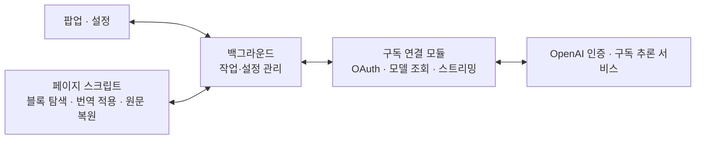

# Yongil Translator 개발 기획안

- 문서 버전: 0.3
- 작성·검토일: 2026-10-15
- 상태: 기획 기준 문서. 구현 현황과 미검증 항목은 README.md·TESTING.md 참고
- 배포 방향: 오픈소스 공개 배포
- 대상: 데스크톱 Chromium 기반 브라우저. Chrome 우선 검증, Edge·Brave 호환 검증
- 작성 범위: 제품 요구사항, 기술 설계, UI, 오류 처리, 검증 기준. 구현 코드는 포함하지 않는다.

## 1. 제품 목표와 확정 요구사항

웹페이지의 텍스트를 사용자의 ChatGPT 구독 계정으로 번역하고, 번역 결과를 해당 페이지의 원래 위치에 표시한다. 페이지 전체와 포인터가 가리키는 블록을 각각 번역할 수 있고, 두 경우 모두 원문으로 되돌릴 수 있어야 한다.

| ID | 확정 요구사항 |
|---|---|
| R-01 | 로컬 프로그램이나 로컬 서버 설치 없이 확장 프로그램만으로 인증·번역한다. |
| R-02 | 첫 버전은 ChatGPT 구독 계정으로만 연결한다. 사용자 API 키 연결은 후속 범위다. |
| R-03 | 계정 로그인, 로그인 상태 표시, 세션 갱신, 로그아웃을 제공한다. |
| R-04 | 번역할 타겟 언어와 모델을 선택할 수 있다. 소스 언어는 항상 자동 인식한다. |
| R-05 | 타겟 언어는 직접 입력과 목록 선택이 가능한 Editable Combobox다. |
| R-06 | 최초 타겟 언어는 시스템 언어를 기본으로 하고, 언어 목록 최상단에 표시한다. 확장 단독 환경에서의 정확한 감지 가능성은 7절에서 별도로 검토한다. |
| R-07 | 기본 페이지 번역 단축키는 Alt+Shift+T다. |
| R-08 | Alt+Shift를 누르고 있는 동안 포인터 아래 블록이 하이라이트되고, 클릭하면 해당 블록을 번역한다. |
| R-09 | 제공하는 모든 키 조합은 변경하거나 해제할 수 있다. 브라우저·OS에서 허용하는 조합을 지원한다. |
| R-10 | 커스텀 인스트럭션으로 톤·스타일·용어 사용 등을 지정한다. |
| R-11 | 페이지 전체 원문 복원과 개별 블록 원문 복원을 모두 지원한다. |
| R-12 | 페이지 번역으로 바뀐 블록 하나만 복원하거나, 블록별로 번역한 내용을 페이지 단위로 모두 복원할 수 있다. |
| R-13 | 원문 복원에는 GPT 요청과 추가 구독 사용이 필요하지 않다. |
| R-14 | 오픈소스로 공개하고 배포한다. |
| R-15 | 대표 아이콘과 UI 아이콘을 일관된 시각 스타일로 디자인하고, 작은 크기와 밝은·어두운 테마에서의 식별성을 확보한다. |

이 문서에서 초기값·기술 선택·추가 UX는 설계 제안이다. 실기 검증이 필요한 항목은 검증 필요로 표시하고, 원래 요구사항을 임의로 대체하지 않는다.

## 2. 기술 구성과 책임

### 2.1 제안 기술 기반

| 영역 | 제안 |
|---|---|
| 확장 규격 | Manifest V3 |
| 언어 | TypeScript |
| 빌드 | Vite 기반 번들링. 실행 코드는 확장 패키지에 포함 |
| 팝업·설정 UI | React와 CSS. 사용자 환경의 밝은/어두운 테마 지원 |
| 페이지 처리 | Content Script와 표준 DOM API |
| 페이지 위 UI | Shadow DOM으로 스타일을 분리한 하이라이트·상태 표시·블록 도구막대 |
| 요청 처리 | Service Worker의 구독 연결 모듈 |
| 설정·인증 상태 | chrome.storage.local 및 chrome.storage.session |
| 검증 도구 후보 | 단위 검증: Vitest, 실제 확장 동작: Playwright와 격리된 Chromium 프로필 |

최소 브라우저 버전과 라이브러리 버전은 구현 시작 시 사용하는 API와 지원 대상에 맞춰 고정한다. Shadow DOM은 스타일 충돌 완화 수단이며 인증정보의 보안 경계로 취급하지 않는다.

### 2.2 구성요소

| 모듈 | 책임 |
|---|---|
| Popup | 연결 상태, 언어·모델 선택, 페이지 번역, 블록 선택 진입, 페이지 원문 복원 |
| Options | 인스트럭션, 단축키, 사이트 권한, 계정, 데이터 설정 |
| Content Controller | DOM 탐색, 블록 식별, 입력 이벤트, 하이라이트, 결과 적용·원문 복원 |
| Job Coordinator | 작업 생성, 문서·블록 버전 관리, 진행률, 중복 방지, 중지·재시도 |
| Subscription Adapter | OAuth, 토큰 갱신, 모델 목록, 번역 요청·응답 해석 |
| Settings Store | 설정 스키마, 저장·변경 알림, 이전 설정 마이그레이션 |
| Session Store | 진행 중 작업의 최소 메타데이터와 로그인 시도 상태 |



콘텐츠 스크립트에는 토큰을 전달하지 않는다. 페이지에서 얻은 텍스트와 블록 식별정보만 전달하고, 인증과 외부 요청은 백그라운드에서 처리한다. 나중에 API 키 연결을 추가하더라도 페이지 처리와 UI의 기본 계약은 유지한다.

## 3. 브라우저 단독 구독 인증

### 3.1 채택 방향과 검증 경계

로컬 프로그램, Native Messaging Host, 개발자 운영 프록시 서버를 요구하지 않는 OAuth Authorization Code + PKCE 구성을 채택한다. 로그인 탭이 콜백 주소로 이동할 때 해당 탭의 URL에서 인증 코드를 읽는 방식을 우선 검증한다.

구독 연결의 초기 후보는 공개 Codex 클라이언트의 인증 흐름과 호환되는 방식이다. 앱 자체를 새로 등록하는 공식 외부 앱 연동과는 구별한다. 현재 공개된 공식 문서는 별도 등록 흐름, 공개 Responses 엔드포인트, 브라우저 외부의 보호된 토큰 보관을 안내하므로, 아래 브라우저 단독 후보를 공식 지원 방식으로 표시하지 않는다.

참고: [공식 외부 앱 구독 연결 개요](https://developers.openai.com/siwc/token-sharing-open-source), [공식 인증 흐름](https://developers.openai.com/siwc/token-sharing-open-source/sign-in), [공식 토큰 보관 안내](https://developers.openai.com/siwc/token-sharing-open-source/profiles-and-sessions).

| 목적 | 구현 시 검증할 후보 |
|---|---|
| 인증 페이지 | https://auth.openai.com/oauth/authorize |
| 인증 코드 교환·토큰 갱신 | https://auth.openai.com/oauth/token |
| 로그인 콜백 | http://localhost:1455/auth/callback |
| 모델 목록 | https://chatgpt.com/backend-api/codex/models |
| 번역 요청 | https://chatgpt.com/backend-api/codex/responses |

콜백 주소에 접속을 시도하더라도 실제 localhost 서버를 실행하거나 설치하지 않는다. URL 관찰과 코드 교환이 현재 브라우저·계정에서 동작하는지는 첫 기술 검증 항목이다. 로그인, 모델 조회, 실제 번역, 세션 갱신까지 성공해야 구독 연동이 검증된 것으로 판단한다.

구독 종류별 사용 가능 범위와 모델 접근 권한도 실응답으로 확인한다. 구독 가입 사실만으로 모든 계정·모델에서 동작한다고 표시하지 않는다. 이 방식이 동작하지 않으면 연동 불가 상태를 안내하고 설계를 재검토하며, 사용자 동의 없이 API 과금 방식이나 로컬 설치 방식으로 전환하지 않는다.

### 3.2 로그인 순서

1. 사용자가 팝업 또는 설정에서 Continue with ChatGPT를 누른다.
2. 백그라운드가 loginAttemptId, PKCE verifier/challenge, state, 만료 시각을 생성한다. OIDC를 사용하면 nonce도 생성한다.
3. 전용 로그인 탭을 생성하고, 해당 tabId와 로그인 시도 정보를 연결한다.
4. 이 로그인 탭만 관찰한다. 다른 탭의 콜백이나 일반 탐색 기록을 수집하지 않는다.
5. 리디렉션 URL을 URL 객체로 해석하고 scheme, hostname, port, pathname이 예상값과 정확하게 일치하는지 검사한다. 문자열 접두사 비교만 사용하지 않는다.
6. state가 없거나 다르면 거부한다. 제공자가 반환한 OAuth 오류는 코드 교환 전에 처리한다.
7. 유효한 코드를 한 번만 처리하고 PKCE verifier와 함께 교환한다. 중복 탭 이벤트가 코드 교환을 반복하지 않도록 한다.
8. 토큰 응답을 검증한다. ID token을 신뢰할 때는 서명, issuer, audience, 만료, 요청한 nonce를 검증하며 단순 디코딩 결과만 신뢰하지 않는다.
9. 계정 상태를 갱신하고 모델 목록을 조회한다. 로그인 탭과 임시 인증정보를 정리한다.
10. 팝업이 닫혀 있으면 완료 상태만 저장하고, 다시 열 때 표시한다.

콜백 탭의 페이지가 정상적으로 로드되지 않는 경우에도 URL 또는 pendingUrl을 관찰할 수 있는지 검증한다. 감지 실패는 시간 초과로 종료하고 다시 로그인할 수 있게 한다. 인증 코드가 포함된 전체 URL은 로그에 기록하지 않는다.

### 3.3 인증 상태

| 상태 | 의미 | UI |
|---|---|---|
| signed_out | 연결된 계정 없음 | 로그인 버튼 |
| signing_in | 사용자 인증 또는 코드 교환 중 | 로그인 중, 취소 |
| connected | 인증정보 확보 및 현재 요청 가능 | 계정 정보, 모델 선택 |
| refreshing | 사용 전 세션 갱신 중 | 짧은 연결 갱신 표시 |
| reauth_required | 갱신 실패·권한 회수 등으로 재인증 필요 | 다시 로그인 |
| unavailable | 계정 또는 연결 경로에서 구독 사용 불가 | 이유와 재시도 경로 |
| usage_limited | 제공자 사용량 제한 | 사용량 관리, 재시도 가능 시각이 있으면 표시 |

사용량 제한과 로그인 만료를 구분한다. 사용량 제한을 재로그인으로 해결할 수 있다고 안내하지 않는다.

### 3.4 토큰과 로그인 시도 보관

- 로그인 유지용 토큰은 확장 전용 local 저장소에 보관하는 것을 초기안으로 한다.
- local 저장소의 접근 수준을 TRUSTED_CONTEXTS로 제한하고, 콘텐츠 스크립트는 필요한 설정만 메시지로 받는다. 이 설정은 확장 자체 페이지까지 차단하는 기능은 아니므로 UI 코드에도 토큰을 전달하지 않는 구조를 유지한다.
- PKCE verifier, state, nonce, loginAttemptId, 로그인 탭 ID는 만료가 있는 session 저장소에 둔다.
- 설정 내보내기, 진단 로그, 오류 메시지에는 토큰·인증 코드·PKCE verifier를 포함하지 않는다.
- 브라우저 전용 저장소를 OS 보안 저장소와 동등한 암호화 저장소로 설명하지 않는다.
- 토큰 갱신은 동일 연결에 대해 한 번만 수행하고 최신 refresh token을 교체 저장한다.
- 로그아웃은 진행 중 요청을 중단하고 토큰을 삭제한다. 서버 측 폐기는 해당 인증 경로에서 지원되는 방법을 검증해 적용하며, 로컬 삭제만으로 서버 연결도 해제됐다고 표시하지 않는다.

Chrome의 저장소 접근 제어와 session 수명은 [Storage API 문서](https://developer.chrome.com/docs/extensions/reference/api/storage)를 기준으로 검증한다.

## 4. 확장 권한과 실행 수명

### 4.1 권한 제안

| 항목 | 용도 |
|---|---|
| storage | 설정·인증 상태 저장 |
| activeTab | 사용자가 확장을 실행한 현재 탭에서 일회성 페이지 작업 |
| scripting | 허용된 탭에 스크립트 주입·등록 |
| tabs | 확장이 연 로그인 탭의 URL과 탐색 상태 관찰 |
| 인증·추론 도메인 host_permissions | 필요한 인증, 모델 조회, 번역 요청 |
| http/https 사이트 optional_host_permissions | 허용된 사이트에서 블록 선택 이벤트 상시 감지 |
| manifest의 commands 항목 | 페이지 번역과 원문 복원 등 브라우저 단축키 등록 |

commands는 manifest 설정 항목이며 permissions 배열에 넣는 권한 문자열로 취급하지 않는다. 초기 버전에 cookies, debugger, nativeMessaging 권한은 요구하지 않는다. 실제 host_permissions는 검증된 통신 대상만 명시한다.

사용자는 전체 지원 사이트 또는 선택한 사이트에서 사용할 수 있다. 지속 권한을 허용한 사이트에는 입력 감지용 스크립트를 등록하되, 텍스트 수집과 외부 전송은 사용자가 번역을 실행했을 때 시작한다.

activeTab만으로 모든 새 페이지에서 Alt+Shift를 미리 감지할 수 있다고 가정하지 않는다. 영구 사이트 권한이 없는 경우 팝업이나 브라우저 명령 실행으로 현재 탭을 활성화한 뒤 동작하게 한다. 이미 열린 탭의 스크립트 적용과 권한 회수 시 동작도 처리한다.

근거: [activeTab](https://developer.chrome.com/docs/extensions/develop/concepts/activeTab), [Content Scripts](https://developer.chrome.com/docs/extensions/develop/concepts/content-scripts), [Commands API](https://developer.chrome.com/docs/extensions/reference/api/commands).

### 4.2 서비스 워커 재시작 대응

Manifest V3 서비스 워커는 상시 실행 프로세스가 아니다. 로그인과 작업 상태를 메모리 변수만으로 관리하지 않는다.

- 이벤트 리스너는 워커 시작 시 등록한다.
- 진행 중 작업 ID, 문서 식별자, 완료·대기 블록 상태 등 최소 정보는 session 저장소에 둔다.
- 팝업 수명과 작업 수명을 분리한다. 팝업을 닫는 동작은 번역 취소가 아니다.
- 워커가 다시 시작되면 살아 있는 문서와 작업 상태를 확인한다.
- 종료된 네트워크 스트림을 그대로 이어받았다고 가정하지 않는다. 완료를 확인하지 못한 요청은 중단 상태로 처리한다.
- 자동 재개는 미완료 블록에 한정하며, 중복 요청으로 사용량이 발생할 수 있는 불확실한 상태는 사용자 재시도로 처리한다.
- 로그인 탭이 닫혔거나 기한이 지난 로그인 시도는 정리한다.
- 아무 작업이 없는데도 워커를 무기한 유지하는 구조는 사용하지 않는다.

참고: [서비스 워커 수명](https://developer.chrome.com/docs/extensions/develop/concepts/service-workers/lifecycle).

## 5. 번역과 원문 복원 엔진

### 5.1 번역 대상과 블록 정의

블록은 사용자가 독립적인 문맥으로 읽고 선택할 수 있는 최소 의미 단위다. 문단, 제목, 목록 항목, 표의 셀, 인용문 등을 우선한다.

- 작은 span이나 링크 위에 포인터가 있어도 적절한 문단 블록을 선택한다.
- body나 페이지 전체 컨테이너가 한 블록으로 선택되지 않게 크기와 구조를 평가한다.
- 부모와 자식 블록의 중복 수집을 방지한다.
- viewport 밖에 있으나 현재 문서에 로드되어 렌더링되는 내용도 페이지 번역 범위에 포함한다.
- script, style, 코드 블록, 숨김 요소, 입력창, 비밀번호 필드, 편집 중인 영역, 확장 자체 UI는 기본 제외한다.
- 이미지·Canvas의 글자, PDF, 브라우저 내부 화면은 초기 번역 범위에서 제외한다.
- iframe은 해당 프레임의 접근 권한과 지원 여부를 확인한다. 접근하지 못한 프레임까지 번역 완료로 표시하지 않는다.
- 열려 있는 Shadow Root는 별도 탐색 검증 대상으로 두고, 닫힌 Shadow Root 내부까지 지원한다고 약속하지 않는다.

### 5.2 블록 데이터

| 필드 | 의미 |
|---|---|
| documentId / navigationEpoch | 현재 문서·탐색 세대를 식별 |
| frameId | 블록이 속한 프레임 |
| blockId | 문서 안에서의 안정적인 블록 ID |
| sourceRevision | 사이트가 원문을 갱신한 버전 |
| displayGeneration | 번역·복원·재번역마다 바뀌는 결과 적용 세대 |
| originalNodes | 원문 Text 노드 참조와 텍스트 스냅샷 |
| lastAppliedNodes | 확장이 마지막으로 적용한 값 |
| translatedNodes | 검증된 번역 결과 |
| settingsFingerprint | 언어·모델·인스트럭션·프롬프트 버전 |
| state | original, queued, translating, translated, failed, stale |
| restoreRequested | 사용자가 원문 복원을 요청해 이전 결과 적용을 차단했는지 |

원문은 번역문으로 덮어 저장하지 않는다. 재번역도 원문에서 시작한다. 원문 복원용 스냅샷은 일반 번역 캐시의 삭제·퇴출과 별도로 관리한다.

### 5.3 페이지 번역 처리

1. 실행 시점의 계정, 모델, 타겟 언어, 인스트럭션을 작업 설정으로 고정한다.
2. 현재 문서의 번역 가능한 블록을 수집하고 원문을 기록한다.
3. 현재 보이는 블록을 먼저 처리하고 나머지 로드된 블록을 이어서 처리한다.
4. 블록 ID와 문맥을 포함한 요청을 적절한 크기로 묶는다.
5. 응답 완료 여부와 결과 구조를 검증한다.
6. 현재 문서·블록의 세대와 해당 작업에 고정된 settingsFingerprint가 일치하는지 확인한 후 번역을 적용한다. 전역 설정만 바꾼 경우 진행 중 작업의 설정은 유지한다.
7. 부분 실패는 해당 블록을 원문으로 유지하고 재시도 대상으로 표시한다.

초기 동시 요청 수는 계정 전체 기준 2개로 제안한다. 여러 탭이 동시에 번역해도 제한을 공유한다. 선택 블록 번역을 아직 시작하지 않은 페이지 배치보다 우선한다. 배치 크기는 입력 문맥과 출력 여유를 함께 고려해 검증 후 조정한다.

### 5.4 구조 보존과 응답 검증

문단 전체 문맥과 노드 식별자를 모델에 제공하고, 노드별 번역 텍스트를 받는다. 생성된 HTML을 그대로 삽입하지 않는다.

필수 검증은 요청 블록·노드 ID의 일치, 누락·중복 여부, 값의 타입, 비정상적인 빈 문자열, 출력 길이, 보존 대상의 손상 여부다. 지원 모델에서는 구조화 출력을 활용하되, 모든 모델이 동일한 출력 기능을 지원한다고 가정하지 않는다.

링크와 강조가 있는 문장은 기존 요소와 이벤트 연결을 유지하는 것을 우선한다. 노드 순서를 보존하는 방식이 언어별 어순과 번역 자연스러움에 주는 영향은 품질 검증 항목이다. 오른쪽에서 왼쪽으로 쓰는 언어도 문서 전체 방향을 무조건 변경하지 않고 블록별 표시를 검증한다.

스트리밍 조각은 작업 진행 상태에 사용할 수 있지만, 검증되지 않은 부분 응답으로 원문을 없애지 않는다. 정상 종료 이벤트와 결과 검증까지 확인한 배치를 완료 처리한다. 스트림 단절·실패·미완료는 성공과 구분한다.

### 5.5 블록 원문 복원 — 필수

블록을 어떤 방식으로 번역했는지와 무관하게 그 블록만 원문으로 되돌릴 수 있어야 한다.

- 번역된 블록의 도구막대에 원문 복원 버튼을 제공한다.
- 블록 선택 키를 누르면 번역된 블록에는 클릭하여 원문 복원 안내를 표시한다. 이 상태에서 클릭하면 해당 블록만 복원하는 UX를 제안한다.
- 페이지 전체 번역으로 번역된 블록에도 동일하게 적용한다.
- 주변 블록의 번역 상태는 유지한다.
- 번역 대기·진행 중인 블록도 도구막대의 중지하고 원문 유지로 복원 의사를 기록할 수 있다.
- displayGeneration을 먼저 증가시키고 대기열에서 제외한 뒤 원문을 복원한다. 늦게 도착한 이전 결과는 폐기한다.
- 여러 블록을 묶은 요청이라 해당 블록만 네트워크 취소할 수 없으면, 다른 블록은 처리하되 복원한 블록의 결과만 버린다.
- 진행 중인 페이지 작업이나 DOM 변경 감시가 복원한 블록을 자동으로 다시 번역하지 않게 한다.
- 다시 번역하려면 사용자가 해당 블록 또는 페이지 번역을 명시적으로 실행한다.

### 5.6 페이지 원문 복원 — 필수

팝업, 페이지 상태 도구막대, 사용자가 지정한 원문 복원 단축키에서 실행한다.

1. 현재 문서의 번역 작업과 결과 적용 세대를 무효화한다.
2. 미시작 요청을 취소하고 진행 중 요청은 가능한 범위에서 중단한다.
3. 페이지 전체 번역과 개별 블록 번역으로 바뀐 모든 추적 블록을 복원한다.
4. 하이라이트·진행 상태·확장이 변경한 관련 속성을 정리한다.
5. 복원 결과에 따라 원문 또는 일부 복원 불가 상태를 표시한다. 이미 원문인 페이지에서 재실행해도 안전해야 한다.

전체 원문 복원은 개별 블록 번역 결과까지 포함한다. 새 번역 요청을 보내지 않으며, 네트워크 연결이나 로그인 상태와 무관하게 현재 문서에 보관된 원문으로 수행한다. 이미 제공자에 전달된 번역 요청의 사용량까지 취소된다고 안내하지 않는다.

### 5.7 사이트 자체 변경과 충돌 처리

복원은 페이지 전체 HTML 스냅샷을 덮어쓰는 방식으로 하지 않는다. 기존 노드를 유지하고 확장이 변경한 값만 되돌린다.

- 노드가 그대로 있고 현재 값이 lastAppliedNodes와 일치하면 저장된 원문을 복원한다.
- 사이트가 노드를 삭제·교체하거나 내용을 갱신했다면 오래된 원문으로 덮어쓰지 않는다.
- 새 내용을 최신 원문으로 재평가하고 기존 결과를 stale로 처리한다.
- 복원하지 못한 블록이 있으면 수량과 이유를 표시한다. 원문 복원 완료라고 허위 표시하지 않는다.
- 원문·번역문 전환과 스타일 변경은 MutationObserver가 새 원문 변경으로 오인하지 않도록 변경 출처를 추적한다.

## 6. 번역 작업 상태와 취소

| 상태 | 의미 |
|---|---|
| original | 현재 문서는 원문 상태 |
| preparing | 블록 수집·설정 고정 중 |
| translating | 번역 요청 처리 중 |
| partial | 일부 블록만 번역되었거나 개별 복원으로 혼합 상태 |
| completed | 이번 작업의 대상 블록 처리가 완료됨 |
| stopped | 새 요청을 중단하고 이미 적용한 번역은 유지 |
| failed | 실행을 계속할 수 없는 오류 |
| restoring | 원문 복원 중 |

중지와 원문 복원은 서로 다른 기능이다. 중지는 이미 적용한 번역을 유지하고 새 요청·미적용 결과를 중단한다. 원문 복원은 번역된 화면도 원문으로 되돌린다.

번역 중 Alt+Shift+T를 다시 눌러도 같은 작업을 중복 생성하지 않는다. 완료된 동일 설정의 페이지에서 재실행하면 새로 추가되거나 원문으로 복원된 대상만 처리하며, 전체 재번역은 별도 명시적 동작으로 제공한다.

페이지 이동, 탭 종료, 설정을 바꾼 뒤 재번역, 로그아웃 등으로 이전 작업이 종료되면 늦게 도착한 결과를 적용하지 않는다. 로그아웃만으로 이미 표시된 번역문을 강제 복원하지는 않는다.

## 7. 언어·모델·커스텀 인스트럭션

### 7.1 타겟 언어 Editable Combobox

검색과 직접 입력, 목록 선택을 하나의 입력 요소에서 제공한다. 별도의 Other 입력란으로 이동시키지 않는다.

| 항목 | 동작 |
|---|---|
| 초기값 | 시스템 언어를 우선하는 요구사항 유지. 감지 방식은 7.2절의 검증·결정 항목 |
| 최상단 | 기본 언어 항목을 고정하고 감지 출처를 정확히 표시 |
| 검색 | UI 언어의 언어명, 원어 이름, 영어 이름, 언어 코드로 검색 |
| 목록 표시 | 예: 한국어 · Korean, English · 영어 |
| 직접 입력 | 검색 결과가 없어도 입력한 언어명으로 확정 가능 |
| 입력 확정 | Enter 또는 명시적 사용자 지정 항목 선택 |
| 비어 있는 값 | 번역 실행을 막고 타겟 언어 입력 안내 |
| 저장 | 마지막으로 확정한 값을 보관. 사용자가 변경한 값을 재실행 때 초기값으로 덮어쓰지 않음 |
| 기본값 복귀 | 기본 언어 사용 선택. 감지된 기본값을 다시 적용 |
| 중복 제거 | 같은 언어·지역 항목은 중복 표시하지 않음 |
| 키보드 접근 | 방향키로 탐색, Enter로 선택, Escape로 목록 닫기 |
| 사용자 지정 언어 | 유효한 자유 입력임을 표시하되 특정 모델의 번역 품질을 보장하지 않음 |

일반 언어는 가능한 범위에서 BCP 47 코드로 정규화한다. 중국어 간체·번체, 영어 지역 변형처럼 의미 있는 구분은 보존한다. 사용자 지정 언어는 정규화된 코드와 혼동하지 않도록 label과 rawValue를 별도 보관한다. 빈 문자열과 제어문자를 검증하고 길이 상한은 초기 제안값 100자로 둔다.

콤보박스 안의 Escape 등 표준 위젯 탐색키와 사용자가 재지정하는 번역 기능 단축키는 구분한다. 위젯을 편집하는 동안 페이지 번역·블록 선택 단축키가 오작동하지 않게 한다.

### 7.2 시스템 언어 감지: 추가 확인이 필요한 요구사항

사용자가 요구한 기본값은 OS의 시스템 언어다. 다만 chrome.i18n.getUILanguage()는 브라우저 UI 언어이고 getAcceptLanguages()는 브라우저의 선호 언어이므로, OS 표시 언어와 같다고 단정할 수 없다.

확장 단독 환경에서 정확한 OS 표시 언어를 얻는 지원 경로를 확인한다. 확인되지 않으면 브라우저 UI 언어를 초기 추천값으로 쓰는 대안을 제안하되, 이를 시스템 언어라고 표시하지 않는다. 정확한 시스템 언어 대신 이 대안을 채택하는 것은 추가 제품 결정으로 남긴다. 이 차이를 해결하기 위해 로컬 프로그램 설치 요구를 도입하지 않는다.

기술 검증에서 브라우저 언어를 임시 기본값으로 사용할 경우 출처를 browser_ui로 기록하고 화면에도 브라우저 기본 언어라고 표시한다. 사용자는 언제든 직접 언어를 선택할 수 있어야 한다.

근거: [Chrome i18n API](https://developer.chrome.com/docs/extensions/reference/api/i18n).

### 7.3 소스 언어 자동 인식

소스 언어 선택 UI와 자동 인식 상태 표시는 제공하지 않는다. 모델이 입력 문맥에서 소스 언어를 인식하고 지정한 타겟 언어로 번역한다. 여러 언어가 섞인 페이지도 블록별로 처리한다.

HTML lang 속성은 참고 정보로만 사용한다. 타겟 언어와 같은 텍스트를 자동으로 생략하는 최적화는 혼합 문장과 짧은 문구를 잘못 건너뛰지 않는 범위에서 검증 후 적용한다. 원문의 숫자, 제품명, URL, 코드 식별자 등 보존 기준은 기본 번역 지침에 포함한다.

### 7.4 모델 선택

- 로그인 후 해당 연결에서 조회한 모델 목록을 표시한다.
- UI용 displayName과 요청용 modelId를 별도로 보관한다.
- 연결 변경·재로그인 시 목록을 다시 조회하고 수동 새로고침을 제공한다.
- 조회 실패 시 이전 목록이 있으면 이전 조회 결과라고 표시한다. 검증하지 않은 고정 목록을 현재 사용 가능한 모델이라고 표시하지 않는다.
- 저장된 모델이 사라지면 다른 모델로 자동 전환하지 않고 재선택을 요청한다.
- 모델 목록에 있다는 사실과 실제 추론 권한이 있다는 사실을 구분한다. 최종 사용 가능 여부는 요청 응답으로 확인한다.
- 첫 연결에서 모델을 선택하지 않았다면 사용 가능한 목록에서 사용자가 선택하게 한다. 추천 기본 모델은 출시 전 품질·속도 검증으로 정한다.
- 모델 변경은 새 작업부터 적용한다. 진행 중 작업에 설정을 섞지 않는다.
- 추론 강도 등 고급 옵션은 모델별 지원 정보가 확인될 때만 노출하는 후속 후보로 둔다.

계정별 모델 조회와 실제 응답 완료 확인의 원칙은 [모델·추론 문서](https://developers.openai.com/siwc/token-sharing-open-source/models-and-inference)를 참고하되, 채택한 구독 경로의 응답 스키마는 별도로 확인한다.

### 7.5 커스텀 인스트럭션

설정 화면에 여러 줄 입력란과 사용 여부 토글을 제공한다. 초기 입력 상한은 4,000자로 제안하며 최종 제한은 요청 문맥 예산에 맞춰 조정한다.

예시:

> 자연스러운 한국어 존댓말로 번역한다.
> 기술 용어는 일반적으로 사용하는 표현을 쓴다.
> 제품명과 코드 식별자는 유지한다.
> 원문의 의미를 생략하거나 설명을 추가하지 않는다.

앱의 출력 형식·블록 대응·타겟 언어·의미 보존 규칙을 기본 계약으로 둔다. 사용자 인스트럭션은 그 범위에서 톤과 스타일을 조정한다. 페이지에 포함된 지시문은 번역 대상 데이터이며 모델의 실행 지시로 취급하지 않는다. 번역 요청에는 도구 실행 기능을 제공하지 않는다.

설정 변경은 다음 작업부터 적용한다. 기존 번역에 대해서는 새 설정으로 다시 번역을 제공하고 저장된 원문을 사용한다. 인스트럭션의 본문 또는 활성화 상태가 달라지면 캐시 키도 달라져야 한다.

## 8. 단축키와 블록 선택

### 8.1 기본 조합과 변경 방식

| 기능 | 기본 입력 | 변경 방식 |
|---|---|---|
| 페이지 번역 | Alt+Shift+T | 확장 설정의 변경 버튼에서 브라우저 확장 단축키 설정 열기 |
| 블록 선택 | Alt+Shift를 누르고 유지 | 확장 설정에서 키 조합 기록 |
| 원문 블록 번역 | 블록 선택 중 클릭 | 블록 선택 키 조합을 변경하면 함께 적용 |
| 번역된 블록 원문 복원 | 블록 선택 중 클릭하는 방식 제안 | 같은 선택 키 조합 사용, 하이라이트 안내로 현재 행동 표시 |
| 페이지 원문 복원 | 기본 키 미지정 | 브라우저 확장 단축키 설정에서 지정·변경·해제 |
| 선택 모드 취소 | Esc, 또는 선택 키에서 손 떼기 | 취소 키는 확장 설정에서 변경·해제 가능 |
| 블록 선택 토글 진입 | 팝업의 블록 선택 버튼 | 마우스로 진입하는 대체 수단 |

키에서 손 떼기, 창 포커스 상실처럼 입력 상태가 끝난 상황의 정리는 고정된 동작이다. 별도 사용자 단축키로 분류하지 않는다.

Chrome 명령 API는 기본 조합 선언과 현재 할당 조회를 제공한다. 브라우저 명령 조합을 확장 내부 입력창만으로 바꿀 수 있다고 설계하지 않는다. 설정에는 실제 할당값을 조회해 표시하고 변경 화면으로 연결한다. modifier-only 누름 유지와 클릭 조합은 페이지 스크립트에서 별도로 처리한다.

브라우저나 OS가 예약한 조합은 사용할 수 없을 수 있다. 모든 충돌을 사전에 감지할 수 있다고 보장하지 않고, 미할당 상태와 확장 자체 중복을 검출하며 실제 입력 테스트를 제공한다. [Chrome Commands API](https://developer.chrome.com/docs/extensions/reference/api/commands).

### 8.2 블록 선택 상세 동작

1. 허용된 페이지에서 선택 키 조합을 누르면 선택 모드에 진입한다.
2. 현재 포인터 위치에서 번역 가능한 블록을 찾는다.
3. 블록 테두리와 행동 라벨을 표시한다. 원문이면 클릭하여 번역, 번역문이면 클릭하여 원문 복원을 표시한다.
4. 클릭하면 현재 블록에 표시된 행동을 수행한다. 선택 모드의 해당 클릭에 한해 링크 이동 등 원래 동작을 차단한다.
5. 키를 유지하면 다른 블록을 계속 선택할 수 있다.
6. 키에서 손을 떼거나 취소 키, 탭 전환, 창 포커스 상실이 발생하면 선택 상태를 해제한다.

하이라이트는 클릭을 가로막는 투명 요소로 전체 화면을 덮지 않고, 테두리 표시와 필요한 제어만 제공한다. 스크롤과 레이아웃 변경 때 위치를 갱신한다.

Alt+Shift를 누른 상태에서 T가 추가되어 페이지 번역 명령이 실행되면 블록 선택을 정리하고 페이지 명령을 우선한다. 다른 키가 추가되면 정확한 조합 여부를 확인한다. 키 반복 이벤트, IME 조합 중 이벤트, 입력창·contenteditable에서의 편집 충돌을 처리한다. OS 입력 언어 전환과 겹칠 수 있으므로 사용자 입력 테스트에서 확인한다.

팝업의 블록 선택 버튼으로 진입한 모드는 한 블록을 처리하면 종료하는 것을 초기 UX로 제안한다. 상시 유지 모드와 별개이며 마우스 중심 사용자도 같은 기능을 사용할 수 있게 한다.

## 9. UI 구성

### 9.1 팝업

팝업은 자주 변경하는 설정과 실행에 집중한다. 폭은 약 380~420px을 초기 제안값으로 두고 긴 언어명·모델명과 작은 화면에서 잘림을 검증한다.

```text
Yongil Translator                              설정

ChatGPT 연결됨
계정 표시                                  계정 관리

번역할 언어        [ 한국어                  ▾ ]
모델               [ 선택한 모델             ▾ ]

커스텀 인스트럭션 적용 중                       편집

[                 페이지 번역                  ]
                 Alt + Shift + T

[ 블록 선택 ]                  [ 이 페이지 원문 복원 ]

ChatGPT 구독 사용                           사용량 관리
```

미로그인 상태에서는 연결 영역에 Continue with ChatGPT를 표시한다. 언어·인스트럭션 등의 설정은 로그인 전에 편집할 수 있지만 번역 실행은 로그인 이후 가능하다.

즉시 선택하는 설정은 변경 시 저장한다. 인스트럭션처럼 긴 텍스트는 설정 화면의 명시적 저장으로 확정한다. 저장 실패 시 성공으로 표시하지 않는다. 팝업을 다시 열면 현재 탭의 실제 작업 상태를 조회한다.

로그인 버튼의 표현과 구독 사용 안내는 [공식 UI 안내](https://developers.openai.com/siwc/ui-ux-guidelines)를 참고한다. 계정의 남은 사용량을 실제로 조회하지 못하면 임의의 잔여량 숫자를 만들지 않고 사용량 관리 링크를 제공한다.

### 9.2 페이지 상태 도구막대

| 상태 | 표시 예시 | 주요 동작 |
|---|---|---|
| 번역 중 | 12 / 38개 블록 완료 | 중지, 이 페이지 원문 복원 |
| 일부 번역 | 20개 번역됨 · 2개 실패 | 실패한 부분 재시도, 원문 복원 |
| 혼합 상태 | 번역문과 원문이 함께 표시됨 | 남은 내용 번역, 원문 복원 |
| 번역 완료 | 한국어로 번역됨 | 원문 복원, 다시 번역 |
| 복원 완료 | 원문으로 되돌림 | 페이지 번역 |
| 일부 복원 불가 | 사이트가 변경한 2개 블록은 덮어쓰지 않음 | 상세 안내 |
| 사용량 제한 | 구독 사용량 제한으로 중단됨 | 사용량 관리, 원문 복원 |

진행률의 분모는 현재 작업에 수집된 지원 대상 블록이다. 번역 실패, 지원 불가, 사용자가 복원한 블록을 구분해서 표시한다. 표시되는 모든 상태는 작업 메타데이터와 실제 적용 상태에서 계산한다.

### 9.3 블록 도구막대

| 블록 상태 | 제공 동작 |
|---|---|
| 원문 | 이 블록 번역 |
| 번역 대기·진행 중 | 중지하고 원문 유지 |
| 번역됨 | 이 블록 원문 복원, 다시 번역 |
| 실패 | 재시도 |
| 사이트 변경 감지 | 현재 내용으로 다시 선택 |

블록 도구막대는 포인터 접근 또는 키보드 포커스로 사용할 수 있어야 한다. 색상만으로 상태를 구분하지 않고 행동 이름을 표시한다. 포커스 테두리, 버튼 라벨, 상태 읽기 영역을 제공하며 긴 진행률 알림을 과도하게 반복하지 않는다.

### 9.4 설정 화면

| 영역 | 포함 항목 |
|---|---|
| 번역 | 기본 타겟 언어, 모델, 커스텀 인스트럭션 사용 여부·본문 |
| 단축키 | 현재 실제 조합, 변경·해제, 조합 기록, 테스트, 기본값 안내 |
| 사이트 | 전체/개별 사이트 접근 상태, 허용·해제, 제외 사이트 |
| 계정 | 계정·연결 상태, 다시 로그인, 로그아웃, 사용량 관리 |
| 데이터 | 임시 번역 캐시 삭제, 설정 내보내기·가져오기, 설정 초기화 |

원문 복원 데이터는 현재 페이지에 적용된 번역이 있는 동안 임의로 삭제하지 않는다. 데이터 삭제 화면에서도 번역 캐시와 원문 복원 데이터를 혼동하지 않게 한다.

### 9.5 대표 아이콘과 UI 아이콘 디자인

대표 아이콘과 기능 아이콘을 첫 버전의 필수 디자인 산출물로 포함한다. 작은 도구모음에서도 알아보기 쉽고, 팝업·설정·페이지 도구막대가 같은 제품으로 느껴지도록 형태와 색상 규칙을 통일한다. 아래 스타일과 색상은 초기 제안이며 시안 검토 후 확정한다.

**대표 아이콘 방향**

- 둥근 모서리의 두 페이지가 겹치고, 가운데의 열린 공간이 연결을 표현하는 심볼을 제안한다. 페이지의 내용이 다른 언어로 이어진다는 의미를 담는다.
- 단순한 실루엣, 충분한 여백, 또렷한 면 구성을 기본으로 한다. 16px에서는 작은 문자나 세부 선 없이도 식별되도록 크기별로 형태를 보정한다.
- 초기 색상 후보는 인디고(#4F46E5)와 청록(#14B8A6)이다. 단색판을 먼저 검토하고, 큰 크기의 색상판에만 절제된 그라데이션을 적용하는 안을 비교한다.
- 밝고 어두운 브라우저 도구모음에서 모두 구분되는 외곽선·면 대비를 확보한다. 팝업 내부 테마와 브라우저 도구모음 테마가 서로 다를 수도 있으므로 각각 확인한다.
- 시안 2~3개를 실제 도구모음 크기, 팝업 헤더, 확장 관리 화면에 배치해 비교하고 최종 심볼과 색상을 선택한다.

**UI 아이콘 체계**

기능 아이콘은 둥근 끝과 모서리를 가진 선형 스타일로 통일한다. 24px 기준 그리드와 약 1.75~2px 선 굵기를 초기값으로 삼고, 실제 16·20·24px 표시에서 선과 여백을 보정한다. 기본 색상은 주변 텍스트를 따르고, 주요 동작·선택·오류에는 역할별 색상 토큰을 적용한다.

| 기능 | 아이콘 방향 | 표시 원칙 |
|---|---|---|
| 페이지 번역 | 문서와 언어 전환 심볼 | 주요 버튼에 페이지 번역 라벨 병기 |
| 블록 선택 | 선택 영역의 네 모서리와 포인터 | 현재 선택 모드와 연결해 표시 |
| 원문 복원 | 뒤로 꺾이는 화살표 | 페이지·블록 범위를 라벨에 명시 |
| 다시 번역 | 원형 재시도 화살표 | 원문 복원과 윤곽을 구분하고 라벨 병기 |
| 번역 중지 | 정지 사각형 | 중지와 원문 복원의 효과를 구분 |
| 타겟 언어 | 언어 심볼과 펼침 표시 | 편집 가능한 입력임을 유지 |
| 모델 선택 | 간결한 겹친 타일 | 실제 모델명을 함께 표시 |
| 커스텀 인스트럭션 | 텍스트와 조절 표시 | 적용 여부와 편집 동작 구분 |
| 설정·계정 | 톱니바퀴·사용자 윤곽 | 제품 전반에서 동일한 형태 사용 |
| 완료·오류·진행 | 체크·느낌표·진행 표시 | 상태 문구를 함께 제공 |

아이콘만 있는 보조 버튼에도 접근 가능한 이름과 포커스·호버 시 툴팁을 제공한다. 핵심 실행 버튼에는 텍스트를 함께 표시한다. 클릭 영역은 그림보다 넓게 확보하고, 키보드 포커스를 명확하게 표시한다. 기능을 식별하는 UI 아이콘과 배경의 대비는 3:1 이상을 디자인 목표로 한다. 진행 애니메이션은 동작 줄이기 설정에 대응한다.

**파일과 적용 규격**

- 편집 원본은 SVG로 관리하고 대표 아이콘의 컬러판·단색판과 작은 크기용 보정본을 함께 보관한다.
- manifest의 icons에는 16·32·48·128px PNG를 준비한다. SVG 원본을 manifest 아이콘으로 직접 지정하지 않는다. [Chrome manifest 아이콘 규격](https://developer.chrome.com/docs/extensions/reference/manifest/icons)
- 브라우저 도구모음용 action.default_icon에는 16·24·32px PNG를 준비하고 화면 배율에 따른 선택과 선명도를 검증한다. 도구모음 아이콘은 정적 이미지로 유지한다. [Chrome Action 아이콘 안내](https://developer.chrome.com/docs/extensions/reference/api/action)
- 팝업·설정·페이지 도구막대의 UI 아이콘은 확장에 포함한 SVG 자산 또는 컴포넌트로 제공한다. 색상·크기·선 굵기는 공통 디자인 토큰으로 관리한다.
- 오픈소스 배포에 대표 아이콘 원본, 크기별 출력본, 사용 규칙과 자산 라이선스를 포함한다. 외부 아이콘 세트를 채택하면 출처와 재배포 조건을 기록한다.

**디자인 완료 기준**

대표 심볼 시안, 최종 SVG 원본과 PNG 출력본, 기능 아이콘 목록, 밝은·어두운 테마 적용 예시, 크기별 검토 시트를 산출물로 삼는다. 실제 16px 크기와 100·125·150·200% 화면 배율에서 잘림·번짐·식별성을 확인하고, 번역·원문 복원·다시 번역이 서로 혼동되지 않는지 검토한다.

## 10. 설정·메시지·데이터 계약

### 10.1 설정 모델

| 필드 | 의미 |
|---|---|
| schemaVersion | 설정 형식 버전 |
| targetLanguage | mode, localeCode, label, customText, detectionSource |
| selectedModelId | 사용자가 선택한 실제 모델 식별자 |
| instructions | enabled, text, revision |
| blockSelectionShortcut | modifier와 선택 방식 |
| cancelSelectionShortcut | 취소 조합 또는 미지정 |
| sitePreferences | 허용·제외 사이트에 대한 제품 설정 |
| translationPreferences | 동적 콘텐츠 처리 등 확정한 옵션 |
| uiPreferences | 테마 등 표시 설정 |

브라우저가 관리하는 명령 단축키는 이 설정의 복사본을 정답으로 삼지 않는다. 실제 값은 commands.getAll()로 읽는다. 사이트 권한도 브라우저의 실제 권한 상태를 기준으로 하고 제품 설정과 동기화한다.

### 10.2 메시지 종류

| 메시지 | 방향 | 용도 |
|---|---|---|
| auth.getStatus / auth.start / auth.signOut | 확장 UI → 백그라운드 | 인증 관리 |
| models.list | 확장 UI → 백그라운드 | 모델 목록 조회 |
| settings.get / settings.update | 확장 UI → 백그라운드 | 설정 읽기·변경 |
| page.translate / page.restore | UI 또는 명령 → 백그라운드 → 문서 | 페이지 작업 |
| block.translate / block.restore | 문서 → 백그라운드 및 문서 내부 | 블록 작업 |
| job.cancel / job.retry | UI·문서 → 백그라운드 | 중지·재시도 |
| job.progress / block.result | 백그라운드 → 해당 문서·UI | 상태·결과 전달 |

작업 메시지는 requestId, jobId, documentId, frameId, blockId, sourceRevision, displayGeneration, settingsFingerprint 중 필요한 식별값을 가진다. tabId와 문서 출처는 메시지 본문의 주장만 믿지 않고 Chrome이 제공한 sender 정보와 대조한다.

인증·토큰 관리 메시지는 확장 자체 UI에서만 허용한다. 콘텐츠 스크립트에 인증정보 조회 경로를 제공하지 않는다. 임의 URL 요청·임의 JavaScript 실행 메시지는 정의하지 않는다. 메시지 타입, 크기, 문자열 길이와 결과 스키마를 양쪽에서 검증한다.

### 10.3 데이터 저장과 삭제

| 데이터 | 저장 위치·수명 |
|---|---|
| 사용자 설정 | local, 사용자가 초기화하거나 확장을 제거할 때까지 |
| 로그인 유지 토큰 | 접근 제한된 local, 로그아웃 시 삭제 |
| 진행 중 로그인 값 | session, 완료·취소·시간 초과 시 삭제 |
| 작업 메타데이터 | session, 작업·문서 수명에 맞춰 정리 |
| 원문 스냅샷·노드 참조 | 해당 문서의 메모리, 페이지 이동·종료 시 해제 |
| 번역 결과 캐시 | 첫 버전은 문서 세션 메모리, 영구 이력은 저장하지 않음 |
| 진단 정보 | 오류 코드·작업 단계 중심. 페이지 원문·번역문·토큰은 기본 기록하지 않음 |

캐시 키에는 원문과 주변 문맥의 해시, 타겟 언어·사용자 지정값, 모델, 연결 구분, 인스트럭션, 프롬프트 버전을 포함한다. 같은 문자열이라도 문맥과 설정이 다르면 재사용하지 않는다. 메모리 캐시에 상한을 두되 현재 적용된 번역의 원문 스냅샷은 캐시 퇴출 대상에 포함하지 않는다.

설정 내보내기는 허용한 설정 필드만 선택해서 직렬화한다. 저장소 전체를 내보내지 않는다. 가져오기는 스키마와 값의 범위를 검증하고 인증정보·실행 코드·알 수 없는 필드는 수용하지 않는다.

## 11. 오류·재시도·개인정보 처리

| 상황 | 처리 |
|---|---|
| 로그인 취소·시간 초과 | 임시 인증값 정리, 다시 로그인 가능 |
| 콜백 state 불일치 | 코드 교환 거부, 해당 시도 종료 |
| 세션 만료 | 한 번의 직렬화된 갱신 시도 후 필요하면 재로그인 |
| 구독 또는 모델 접근 불가 | 원인 표시, 모델 재선택 또는 연결 확인 |
| 429·구독 사용량 제한 | 새 요청 중지, 제공자가 준 재시도 정보와 사용량 관리 표시 |
| 일시적 네트워크 오류·5xx | 제한된 재시도. 초기 제안: 추가 2회, backoff와 jitter |
| 스트림 중단·미완료 | 성공으로 처리하지 않음. 해당 배치는 원문 유지 또는 명시적 재시도 |
| 잘못된 결과 구조 | 해당 블록을 적용하지 않고 실패 처리 |
| 페이지 이동·재렌더링 | 이전 결과 폐기 |
| 복원 이후 늦은 결과 | generation 불일치로 폐기 |
| 접근 불가 페이지 | 지원 범위 안내 |
| 저장소 기록 실패 | 저장되지 않았음을 표시하고 인증·설정 상태 재확인 |

사용자가 번역을 실행한 대상 텍스트와 필요한 문맥만 모델 제공자에게 보낸다. 숨겨진 요소·폼 입력값을 문맥 확보 목적으로 추가 수집하지 않는다. 원본 URL의 쿼리·프래그먼트 등 불필요한 탐색 정보는 요청에 포함하지 않는다.

개발자 서버를 통한 번역 중계·원문 수집은 첫 버전에 포함하지 않는다. 실제 외부 서비스의 데이터 처리 정책은 별개이므로 로컬 캐시 미사용이나 요청의 store=false만으로 외부 보관이 전혀 없다고 안내하지 않는다.

## 12. 최초 사용 흐름

1. 확장 설치 후 팝업을 연다.
2. ChatGPT 구독 연결 안내와 Continue with ChatGPT를 표시한다.
3. 로그인 탭에서 인증을 완료한다.
4. 모델 목록을 가져오고 사용할 모델을 선택한다.
5. 초기 추천 타겟 언어와 감지 출처를 보여주고 수정할 수 있게 한다.
6. 모든 지원 사이트 또는 선택 사이트 사용 권한을 정한다.
7. Alt+Shift+T, Alt+Shift+클릭, 페이지·블록 원문 복원을 짧게 안내한다.
8. 실제 페이지에서 번역을 실행한다.

로그인과 사이트 접근 허용은 별개 상태다. 연결됐더라도 현재 사이트의 블록 선택이 비활성화되어 있으면 활성화 방법을 표시한다.

## 13. 첫 버전과 후속 범위

### 첫 버전 필수

- 브라우저 단독 ChatGPT 구독 인증, 세션 갱신·로그아웃
- 계정 연결 상태와 모델 선택
- 직접 입력 가능한 타겟 언어 선택과 소스 언어 자동 인식
- 페이지 번역 및 포인터 블록 번역
- 페이지·블록 원문 복원과 복원 후 늦은 응답 차단
- 변경 가능한 단축키
- 커스텀 인스트럭션
- 진행률, 중지, 실패한 부분 재시도
- 팝업, 페이지 도구막대, 설정 화면
- 대표 아이콘, 기능 아이콘과 밝은·어두운 테마 디자인
- 사이트 접근 권한 관리
- Chrome 우선 동작과 Edge·Brave 호환 확인

### 후속 후보

- 사용자 API 키 연결과 다른 제공자
- 원문·번역문 병렬 표시
- 사용자가 명시적으로 켠 동적 콘텐츠 자동 번역
- 영구 번역 캐시·용어집·사이트별 프리셋
- PDF·이미지 OCR·자막 등 별도 콘텐츠 형식
- 계정 여러 개의 동시 보관·전환

후속 기능의 빈 입력란이나 작동하지 않는 버튼을 첫 버전 UI에 미리 노출하지 않는다.

## 14. 수용 기준과 검증 계획

아래는 구현 후 확인할 기준이며 현재 테스트가 실행됐다는 의미가 아니다.

| ID | 시나리오 | 통과 기준 |
|---|---|---|
| A-01 | 로컬 프로그램이 없는 환경에서 로그인 | 확장과 브라우저만으로 로그인, 모델 조회, 번역까지 완료 |
| A-02 | 로그인 도중 팝업 닫기 | 인증이 팝업 수명에 종속되지 않고 결과 상태 복원 |
| A-03 | 잘못된 state·콜백·중복 이벤트 | 잘못된 교환 거부, 유효 코드 중복 교환 방지 |
| A-04 | 토큰 갱신을 여러 작업이 동시에 요구 | 동일 연결의 갱신 한 번만 수행, 최신 토큰 유지 |
| A-05 | 로그아웃·설정 내보내기 | 로컬 토큰 삭제, 내보낸 문서에 인증정보 없음 |
| L-01 | 언어 검색·직접 입력·재실행 | 확정한 값 유지, 언어 코드·표시명 혼동 없음 |
| L-02 | OS 언어와 브라우저 언어가 다른 환경 | 감지 출처 정확히 표시, OS 언어라고 오인 표시하지 않음 |
| M-01 | 모델 목록 실패·접근 권한 변경 | 오래된 목록 구분, 다른 모델로 무단 전환하지 않음 |
| K-01 | Alt+Shift+T | 페이지 작업 한 번 실행, 블록 선택과 중복되지 않음 |
| K-02 | Alt+Shift 유지·이동·클릭 | 올바른 블록 하이라이트와 해당 블록 번역 |
| K-03 | 키 변경·해제·OS 충돌·IME | 실제 조합과 안내 일치, 입력·키 상태 고착 없음 |
| T-01 | 링크·강조·목록·표가 있는 문서 | 텍스트 번역과 기본 요소 동작 유지 |
| T-02 | 긴 문서·복수 탭 | 계정 단위 동시성 제한과 일관된 진행률 |
| T-03 | 스트림 단절·일부 누락·잘못된 JSON | 미완료 결과를 성공으로 적용하지 않음 |
| T-04 | 혼합 언어·RTL·긴 번역문 | 소스 자동 인식, 표시·레이아웃 검증 |
| R-01 | 개별 번역한 블록 복원 | 그 블록만 원문 복원, 주변 상태 유지, 외부 요청 0회 |
| R-02 | 페이지 번역 후 블록 하나 복원 | 선택 블록만 복원, 페이지는 혼합 상태 표시 |
| R-03 | 여러 블록을 따로 번역한 뒤 페이지 복원 | 모든 추적 번역 블록 원문 복원 |
| R-04 | 번역 진행 중 페이지 복원 | 대기·진행 결과 무효화, 늦은 응답으로 재번역되지 않음 |
| R-05 | 묶음 요청 중 블록 하나 복원 | 해당 블록 결과만 무효화, 나머지 블록 정상 처리 |
| R-06 | 복원 후 다시 번역 | 원문을 입력으로 사용, 번역문을 재번역하지 않음 |
| R-07 | 복원 전 사이트가 원문·노드를 변경 | 사이트의 새 내용을 오래된 스냅샷으로 덮어쓰지 않음 |
| R-08 | 로그아웃·오프라인 상태에서 원문 복원 | 문서에 남아 있는 스냅샷으로 복원 가능 |
| R-09 | 번역 캐시 삭제 후 원문 복원 | 복원용 스냅샷 유지 |
| D-01 | 서비스 워커 종료·재시작 | 상태 재확인, 중단된 요청을 완료라고 표시하지 않음 |
| D-02 | SPA 이동·가상 목록 노드 재사용 | 다른 문서·내용에 이전 결과가 적용되지 않음 |
| P-01 | 사이트 권한 부여·회수 | 블록 선택·텍스트 처리 권한 상태 일치 |
| B-01 | Chrome·Edge·Brave | 로그인 URL 관찰, 저장소, 명령키, 번역·복원을 각각 확인 |
| V-01 | 대표 아이콘의 작은 크기·배율·테마 | 16px에서도 심볼 식별 가능, 밝은·어두운 배경과 주요 화면 배율에서 잘림·번짐 없음 |
| V-02 | 기능 아이콘과 접근성 | 번역·복원·다시 번역 구분, 버튼 이름·포커스·툴팁 제공, 테마별 대비 확인 |

단위 검증은 콜백 검증, 설정 스키마, 캐시 키, 결과 세대 비교, 상태 전이 등 독립적인 로직을 대상으로 한다. 통합 검증은 실제 확장에서 권한·탭·서비스 워커·DOM을 함께 확인한다. 제공자 응답 모의 검증과 실제 구독 계정 검증 결과를 구분해서 기록한다.

## 15. 구현 전 남은 검증·제품 결정

| 항목 | 현재 상태 | 완료 조건 |
|---|---|---|
| 브라우저 단독 OAuth·구독 추론 | 방향 확정, 실동작 미검증 | 설치 없이 로그인·모델 조회·번역·갱신 성공 |
| 시스템 언어 기본값 | 요구사항 확정, 감지 방식 미확정 | 확장 단독 감지 가능성 확인 또는 브라우저 UI 언어 대안에 대한 제품 결정 |
| 모델 기본값 | 미확정 | 실제 사용 가능한 모델의 번역 품질·지연 검증 |
| 번역된 블록 선택 클릭 | 원문 복원 토글 UX 제안 | 행동 라벨과 버튼을 포함한 사용성 검토 |
| DOM 구조 보존 | 설계 제안 | 인라인 서식·SPA·표에서 번역과 복원 검증 |
| 최소 브라우저·OS 버전 | 미확정 | 사용 API와 대상 브라우저 실기 검증 |
| 서버 측 로그아웃 | 경로별 검증 필요 | 지원되는 토큰 폐기·연결 해제 방법 확인 |
| 아이콘 시각 스타일 | 디자인 요구 확정, 형태·색상은 제안 | 대표 심볼 시안 비교와 기능 아이콘·테마별 검토 완료 |
| 공개 배포 | 방향 확정 | 라이선스, 설치 문서, 개인정보 안내, 배포 패키지 검토 |

이 항목들은 기획의 미확정 부분을 명시한 것이며 로컬 프로그램 설치를 요구하는 조건으로 사용하지 않는다.

## 16. 개발 진행 순서 제안

1. **인증 가능성 검증:** 브라우저 단독 로그인, 콜백, 모델 목록, 단일 번역, 갱신을 확인한다.
2. **블록 번역·복원:** 한 블록의 원문 저장, 번역 적용, 원문 복원, 늦은 응답 무효화를 완성한다.
3. **페이지 작업:** 블록 수집, 배치·동시성, 진행률, 페이지 전체 원문 복원을 연결한다.
4. **사용자 UI와 아이콘 디자인:** 대표 심볼과 기능 아이콘을 확정하고 언어·모델·인스트럭션, 팝업·설정·도구막대, 단축키 변경을 완성한다.
5. **동적 페이지·오류 검증:** SPA, 사이트 재렌더링, 권한 회수, 네트워크·사용량 오류를 검증한다.
6. **호환성·공개 배포 준비:** Chrome·Edge·Brave 검증 결과와 지원 범위를 문서화한다.

구현 착수 후 런타임 의존성이 없는 JavaScript ES modules와 표준 DOM API로 구성을 조정했다. webNavigation 권한은 프레임 처리와 문서 이동·로그인 콜백 감지를 위해 추가했다. 최초 언어는 브라우저 UI 언어 기준임을 표시하며, 운영체제 언어와 동일하다고 간주하지 않는다. 현재 구현·검증 범위는 README.md와 TESTING.md를 기준으로 확인한다.
